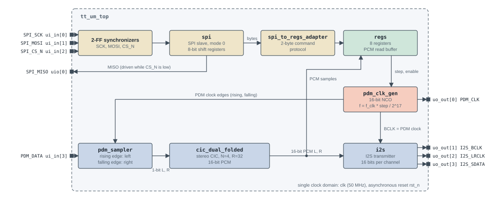
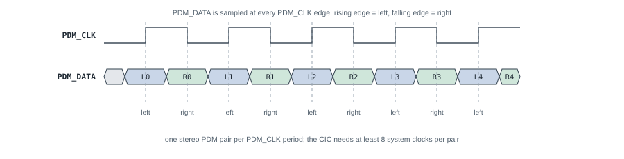
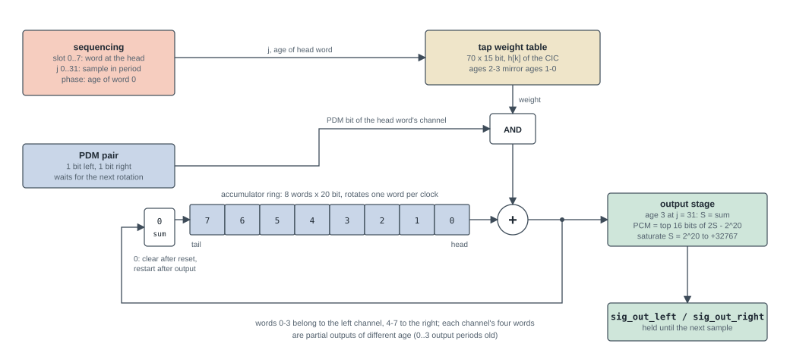
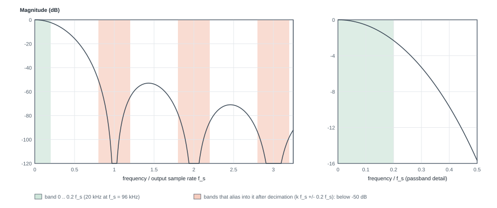
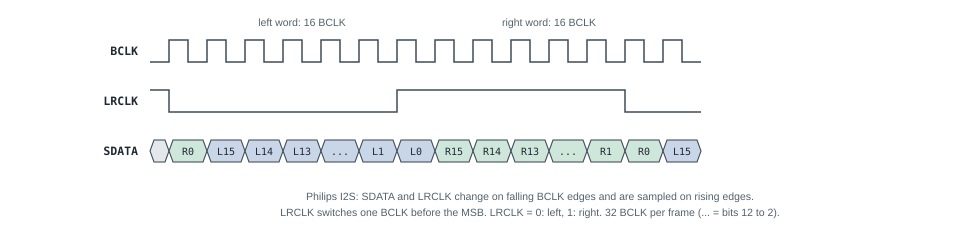
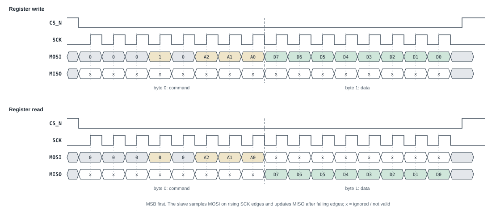
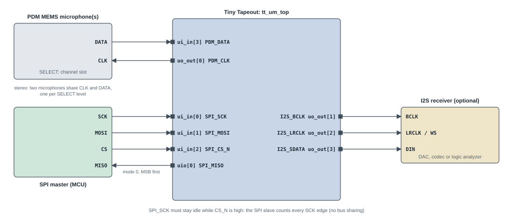

<!---

This file is used to generate your project datasheet. Please fill in the information below and delete any unused
sections.

You can also include images in this folder and reference them in the markdown. Each image must be less than
512 kb in size, and the combined size of all images must be less than 1 MB.
-->

## How it works

### Overview

The PDM-to-PCM converter turns the 1-bit pulse-density-modulated (PDM) output of one or two digital MEMS
microphones into 16-bit stereo PCM audio. It generates the microphone clock, decimates both channels with a
fourth-order CIC filter, and delivers the samples in two ways: as a continuous I²S stream, and as registers that
a microcontroller can read over SPI.

**Features**

- Stereo PDM input on one data pin: left channel on the rising clock edge, right channel on the falling edge
- Programmable PDM clock from a 16-bit numerically controlled oscillator (NCO), 381 Hz resolution at 50 MHz
- CIC decimation filter: order 4, decimation ratio 32, real 16-bit output resolution
- I²S transmitter (Philips format, 16 bits per channel), frame-locked to the PDM clock
- SPI slave (mode 0) with eight 8-bit registers, including tear-free 16-bit reads of the latest samples
- Single 50 MHz clock domain, 1×2 Tiny Tapeout tiles

**Key specifications** (system clock $f_{clk}$ = 50 MHz)

| Parameter | Value |
|-----------|-------|
| PDM clock $f_{PDM}$ | $f_{clk} \cdot step / 2^{17}$; up to 6.25 MHz ($step \le 16384$) |
| PCM sample rate $f_s$ | $f_{PDM} / 32$ per channel, e.g. 48 kHz at 1.536 MHz, 96 kHz at 3.072 MHz |
| PCM format | 16-bit two's complement, full scale −32768 … +32767 |
| Filter | CIC, $N = 4$, $R = 32$, $M = 1$, gain $2^{20}$ |
| Passband droop | −0.57 dB at $0.1\,f_s$, −2.3 dB at $0.2\,f_s$ |
| Alias rejection | > 50 dB into the band 0 … $0.2\,f_s$ |
| Group delay | 62 PDM clock periods (1.94 output samples) |
| I²S | BCLK = $f_{PDM}$, LRCLK = $f_s$, 32 BCLK per frame |
| SPI | mode 0, MSB first, 2-byte transactions, SCK up to 1 MHz recommended |

### Block diagram



Everything runs on the system clock `clk`. `pdm_clk_gen` produces the PDM clock and a strobe for each of its
edges. `pdm_sampler` uses these strobes to split the microphone data into a left and a right bit stream, and
`cic_dual_folded` decimates both streams into 16-bit samples. The `i2s` block serializes the samples, using the
PDM clock as bit clock, and the `regs` block makes them readable over SPI.

### Pin assignment

| Pin | Name | Direction | Function |
|-----|------|-----------|----------|
| `ui_in[0]` | SPI_SCK | input | SPI clock |
| `ui_in[1]` | SPI_MOSI | input | SPI data from the master |
| `ui_in[2]` | SPI_CS_N | input | SPI chip select, active low |
| `ui_in[3]` | PDM_DATA | input | PDM data from the microphone(s) |
| `uo_out[0]` | PDM_CLK | output | PDM clock to the microphone(s) |
| `uo_out[1]` | I2S_BCLK | output | I²S bit clock |
| `uo_out[2]` | I2S_LRCLK | output | I²S word select: 0 = left, 1 = right |
| `uo_out[3]` | I2S_SDATA | output | I²S serial data |
| `uio[0]` | SPI_MISO | output | SPI data to the master; driven only while SPI_CS_N is low |

`ui_in[7:4]` are unused, `uo_out[7:4]` are driven low, and `uio[7:1]` are inputs that are ignored.

### Clock and reset

The design uses one clock, `clk`, designed and timed for 50 MHz. All frequencies in this document scale with
$f_{clk}$. The active-low reset `rst_n` clears all registers asynchronously; hold it low for at least two clock
cycles. After reset the converter is disabled, PDM_CLK and I2S_BCLK are low, and the `id` register reads 0xDA.

SPI_SCK, SPI_MOSI and SPI_CS_N each pass through a two-flip-flop synchronizer before use. PDM_DATA is sampled
directly (see section *PDM input*).

### PDM clock generator

A 16-bit phase accumulator adds the value `step` (register `nco_control`, 0x01–0x02) on every clock cycle while
the converter is enabled. Each accumulator overflow toggles the PDM clock, so

$$f_{PDM} = \frac{f_{clk} \cdot step}{2^{17}}, \qquad step = \frac{f_{PDM} \cdot 2^{17}}{f_{clk}}$$

with a resolution of $f_{clk} / 2^{17}$ = 381.5 Hz. The upper limit comes from the CIC filter, which needs at
least eight clock cycles per PDM period: $step \le 16384$, i.e. $f_{PDM} \le$ 6.25 MHz. Most MEMS microphones
accept clocks of roughly 1 to 3.3 MHz; stay within the range of the microphone used.

PDM clock edges coincide with `clk` edges. When $2^{17} / step$ is not an integer, the PDM period alternates
between the two neighbouring whole numbers of clock cycles: the average frequency is exact, but the clock has up
to one `clk` period (20 ns) of cycle-to-cycle jitter. Values of `step` that are powers of two give a jitter-free
clock.

| Target $f_{PDM}$ | $step$ | Write 0x02, 0x01 | Actual $f_{PDM}$ | $f_s$ | `clk` per PDM period |
|------------------|--------|------------------|------------------|-------|----------------------|
| 768 kHz | 2013 | 0x07, 0xDD | 767.90 kHz | 24.00 kHz | 65.1 |
| 1.024 MHz | 2684 | 0x0A, 0x7C | 1.0239 MHz | 32.00 kHz | 48.8 |
| 1.536 MHz | 4027 | 0x0F, 0xBB | 1.5362 MHz | 48.01 kHz | 32.5 |
| 2.048 MHz | 5369 | 0x14, 0xF9 | 2.0481 MHz | 64.00 kHz | 24.4 |
| 2.400 MHz | 6291 | 0x18, 0x93 | 2.3998 MHz | 75.00 kHz | 20.8 |
| 3.072 MHz | 8053 | 0x1F, 0x75 | 3.0720 MHz | 96.00 kHz | 16.3 |
| jitter-free | 4096 | 0x10, 0x00 | 1.5625 MHz | 48.83 kHz | 32 |
| jitter-free | 8192 | 0x20, 0x00 | 3.1250 MHz | 97.66 kHz | 16 |
| maximum | 16384 | 0x40, 0x00 | 6.2500 MHz | 195.3 kHz | 8 |

While the converter is disabled the accumulator is held at zero and PDM_CLK stays at its last level. With
$step = 0$ the PDM clock does not run.

### PDM input



Stereo PDM microphones share one clock and one data line: each microphone drives the line during one half of the
clock period and releases it during the other. The converter samples PDM_DATA at every PDM clock edge; the value
at the rising edge is the left sample, the value at the falling edge the right sample. The sampling instant is the
`clk` edge that also switches PDM_CLK, so the converter captures the bit that is on the line just before the edge
reaches the microphone. The microphone datasheet states which SELECT level makes it drive the half period that
ends with the rising edge (left) and which the one that ends with the falling edge (right). With a single
microphone, the unused channel contains whatever the undriven data line shows.

PDM_DATA is not synchronized. In normal operation it changes well away from the sampling instant, but it should
not be driven by a source that is asynchronous to PDM_CLK.

### CIC decimation filter

The filter is a cascaded integrator-comb (CIC) decimator with the transfer function

$$H(z) = \left(\frac{1 - z^{-32}}{1 - z^{-1}}\right)^4$$

of which every 32nd output is kept. It is equivalent to an FIR filter with 125 integer coefficients; their sum,
the DC gain, is $32^4 = 2^{20}$.

**Implementation.** Instead of the usual integrator and comb registers, the filter is computed in that FIR form.
The impulse response spans four output periods, so each channel keeps four running sums, each building an output
that is due in 0 to 3 periods. For every PDM bit that is 1, the matching coefficient is added to each of the four
sums. At the end of a period the oldest sum is the finished output and restarts at zero. Because the input bits
are 0 or 1, no multiplier is needed, only a 70-entry coefficient table; the response is symmetric, so half of the
table serves the other half.



The eight 20-bit sums of both channels form a ring that rotates past one shared adder, one sum per clock cycle. A
PDM pair waits at most one rotation and is processed during the next, which is why PDM pairs must be at least
eight clock cycles apart. This form needs 160 bits of filter state, against 336 for a recursive fourth-order CIC.

**Output format.** With PDM bits counted as 0 and 1, the filter sum $S$ lies between 0 (all zeros) and $2^{20}$
(all ones). The output is

$$PCM = \frac{2S - 2^{20}}{32} = \left\lfloor \frac{S}{16} \right\rfloor - 32768$$

saturated at +32767, which is the output of a bipolar (±1) CIC scaled to 16 bits. A PDM stream with 50 % ones
gives 0, all ones give +32767 and all zeros give −32768. All 16 bits are significant.

**Frequency response.** The response falls off towards $f_s / 2$ and has nulls at multiples of $f_s$, which
suppress the modulator noise that would otherwise fold into the audio band during decimation.



| Frequency | Droop | Worst-case rejection of aliases into 0 … this frequency |
|-----------|-------|----------------------------------------------------------|
| $0.05\,f_s$ | −0.14 dB | 102 dB |
| $0.10\,f_s$ | −0.57 dB | 77 dB |
| $0.15\,f_s$ | −1.29 dB | 62 dB |
| $0.20\,f_s$ | −2.31 dB | 50 dB |
| $0.25\,f_s$ | −3.64 dB | 42 dB |
| $0.30\,f_s$ | −5.30 dB | 35 dB |
| $0.40\,f_s$ | −9.67 dB | 24 dB |

For full 20 kHz audio, run the microphone at 3.072 MHz ($f_s$ = 96 kHz): 20 kHz is then at $0.21\,f_s$ (−2.5 dB).
At 48 kHz output the response is −1.6 dB at 8 kHz but −10.5 dB at 20 kHz, which suits speech. There is no
droop-compensation filter on chip; if needed, apply one to the samples in software.

**Latency and settling.** The group delay is 62 PDM clock periods (40 µs at 1.536 MHz). After reset the filter
starts from zero; the first three outputs after enabling are partial sums, and the fourth and later outputs are
exact. Disabling the converter freezes the filter state, so discard the first four samples after re-enabling as
well.

### I²S output



The transmitter sends 16-bit words in the Philips I²S format: MSB first, LRCLK low for the left channel and high
for the right, and the MSB one BCLK after each LRCLK edge. LRCLK and SDATA change on falling BCLK edges; a receiver
samples on rising edges. BCLK is the PDM clock, so one frame of 32 BCLK periods lasts exactly one PCM sample
period, and both words of a frame belong to the same filter output.

BCLK stays low until the filter produces its first output, about 32 PDM periods after enabling; the first left
word starts one BCLK later. Disabling the converter stops BCLK at its current level.

### SPI interface

The SPI slave works in mode 0 (CPOL = 0, CPHA = 0): it samples SPI_MOSI on rising SPI_SCK edges and changes
SPI_MISO after falling edges, MSB first. Every transaction is exactly two bytes, 16 SCK periods. SPI_MISO is driven
only while SPI_CS_N is low and is high impedance otherwise.



The first byte is a command: bit 4 selects write (1) or read (0), and bits 2:0 are the register address. Bits 7:5
and 3 are ignored; write them as 0.

| Byte 0 bit | 7 | 6 | 5 | 4 | 3 | 2 | 1 | 0 |
|------------|---|---|---|---|---|---|---|---|
| Field | 0 | 0 | 0 | W | 0 | A2 | A1 | A0 |

- **Write** (W = 1): the second byte is the data. The register changes a few clock cycles after the 16th rising
  SCK edge.
- **Read** (W = 0): the register is read right after the command byte and returned on SPI_MISO during the second
  byte, for which the master sends any value. SPI_MISO carries no valid data at any other time.

**Timing.** SPI_SCK is oversampled by `clk`. The read data must reach SPI_MISO before the first rising edge of the
second byte, and each later bit before the next rising edge; the synchronizer and register latency limit SCK to
about $f_{clk}/10$ (5 MHz), before the I/O delays of the Tiny Tapeout chip are taken into account. The design was
verified at 1 MHz, the recommended rate. Leave at least one SCK period between transactions.

**Framing.** The slave finds byte and transaction boundaries by counting SCK edges; SPI_CS_N only enables the MISO
driver. SCK must therefore stay low while SPI_CS_N is high, which means the converter cannot share its SCK line
with other SPI devices, and every transaction must have exactly 16 SCK periods. After an incomplete transaction
the framing stays shifted until `rst_n` is asserted.

### Registers

| Address | Name | Access | Reset | Contents |
|---------|------|--------|-------|----------|
| 0x00 | `control` | R/W | 0x00 | bit 0: `enable` |
| 0x01 | `nco_control` low | R/W | 0x00 | `step[7:0]` |
| 0x02 | `nco_control` high | R/W | 0x00 | `step[15:8]` |
| 0x03 | `data_right` low | R | 0x00 | right sample, bits 7:0 |
| 0x04 | `data_right` high | R | 0x00 | right sample, bits 15:8 (snapshot) |
| 0x05 | `data_left` low | R | 0x00 | left sample, bits 7:0 |
| 0x06 | `data_left` high | R | 0x00 | left sample, bits 15:8 (snapshot) |
| 0x07 | `id` | R | 0xDA | device identifier |

Writes to read-only registers are ignored.

**`control` (0x00)**

| Bit | Field | Description |
|-----|-------|-------------|
| 0 | `enable` | 1: run the PDM clock, and with it the whole signal path. 0: stop the PDM clock; the filter, the I²S outputs and the data registers keep their state. |
| 7:1 | — | Reserved, read as 0. |

**`nco_control` (0x01–0x02)**

The 16-bit NCO increment `step` that sets $f_{PDM}$ (see section *PDM clock generator*). Each byte
takes effect as soon as it is written, so between the two writes the NCO runs with a mixed value. Change the
frequency while the converter is disabled, or accept a short interval at the intermediate frequency.

**`data_right` (0x03–0x04), `data_left` (0x05–0x06)**

The latest 16-bit PCM sample of each channel, in two's complement, updated once per sample period. Read the low
byte first: reading it also copies the high byte of the same sample into a buffer, and the high-byte address
returns that buffer. A low-then-high read therefore always returns the two halves of one sample, even if the
filter produces a new sample in between. Reading the high byte again returns the same snapshot; before the first
low-byte read after reset it returns 0x00. Each channel has its own buffer.

**`id` (0x07)**

Always reads 0xDA. Use it to check the SPI connection.

### Programming

1. Release `rst_n`, then read `id` (0x07) and check for 0xDA.
2. Write `step` for the wanted PDM clock: low byte to 0x01, high byte to 0x02.
3. Write 0x01 to `control` (0x00). PDM_CLK starts at once; the I²S stream starts after the first filter output.
4. Discard the first four samples. Then read samples over SPI (low byte, then high byte of `data_left` and
   `data_right`) or take the I²S stream.

To change the PDM frequency, write 0x00 to `control`, update `step`, and enable again.

### Implementation

| Item | Value |
|------|-------|
| Process, area | SkyWater 130 nm (sky130A), 1×2 Tiny Tapeout tiles (161 × 225.76 µm) |
| Standard cells | 2259 instances, 324 flip-flops |
| Cell area | 19 824 µm², 58 % of the core area |
| Timing at 50 MHz | setup slack +10.7 ns in the slowest corner (ss, 100 °C, 1.60 V) |
| Power (estimate) | 1.6 mW at 50 MHz, typical corner |

The RTL was verified in a UVM testbench (repository pdm-to-pcm-verif) against an independent, bit-exact reference
model of the filter: sine and full-scale stimuli at 1.536, 3.072 and 6.25 MHz PDM clock, register tests driven by
the generated register model, and a check of every sample read over SPI, including the snapshot buffer.

### Limitations

- SPI framing depends on counting SCK edges; SPI_CS_N does not resynchronize it (see
  section *SPI interface*).
- The two `nco_control` bytes are not written atomically.
- The on-chip filter is a plain CIC; its passband droop is not compensated.
- Disabling the converter stops PDM_CLK and I2S_BCLK at whatever level they have, which may be high.

## How to test

You need the 50 MHz project clock, an SPI master such as a Raspberry Pi or a microcontroller, and a PDM
microphone. An I²S receiver or a logic analyzer is optional.

1. Connect the microphone, the SPI master and, if available, an I²S receiver as shown in
   section *External hardware*.
2. Reset the design, then read register 0x07. It must return 0xDA; anything else points to a wiring or SPI mode
   problem.
3. Write 0xBB to 0x01 and 0x0F to 0x02 ($step$ = 4027: 1.536 MHz PDM clock, 48 kHz samples), then 0x01 to 0x00.
4. Measure PDM_CLK (`uo_out[0]`) with an oscilloscope or frequency counter: 1.536 MHz. I2S_BCLK runs at the same
   rate and I2S_LRCLK at 48 kHz.
5. Read samples. In a quiet room they stay close to 0; speaking into the microphone gives clearly larger values,
   and tapping or blowing on it drives them towards full scale.

The script below runs on a Raspberry Pi with the `spidev` module (SPI0, CE0):

```python
import spidev
import time

spi = spidev.SpiDev()
spi.open(0, 0)
spi.mode = 0
spi.max_speed_hz = 1_000_000

def read_reg(addr):
    return spi.xfer2([addr & 0x07, 0x00])[1]

def write_reg(addr, value):
    spi.xfer2([0x10 | (addr & 0x07), value & 0xFF])

def read_sample(addr_low):
    """Read a 16-bit sample: low byte first, then the buffered high byte."""
    low = read_reg(addr_low)
    high = read_reg(addr_low + 1)
    value = (high << 8) | low
    return value - 0x10000 if value & 0x8000 else value

assert read_reg(0x07) == 0xDA, "no response from the converter"

write_reg(0x00, 0x00)          # disable while changing the clock
write_reg(0x01, 0xBB)          # step = 4027: 1.536 MHz PDM, 48 kHz samples
write_reg(0x02, 0x0F)
write_reg(0x00, 0x01)          # enable
time.sleep(0.01)               # skip the settling samples

while True:
    left = read_sample(0x05)
    right = read_sample(0x03)
    print(f"left {left:6d}   right {right:6d}")
    time.sleep(0.1)
```

SPI reads are far slower than the sample rate, so they only show snapshots. For continuous audio, record the I²S
stream with an I²S receiver, or with a logic analyzer that decodes I²S (Philips format, 16-bit words, 32 BCLK per
frame).

## External hardware



| Part | Notes |
|------|-------|
| PDM MEMS microphone | Any digital microphone with clock input and PDM output. For stereo, connect two microphones to the same PDM_CLK and PDM_DATA and set their SELECT pins to opposite levels. Check that the microphone accepts the Tiny Tapeout I/O voltage and the chosen PDM clock. |
| SPI master | Raspberry Pi, microcontroller or USB-SPI adapter; mode 0, 1 MHz recommended. Do not share SPI_SCK with other devices (see section *SPI interface*). |
| I²S receiver (optional) | DAC, audio codec or logic analyzer in I²S slave mode: BCLK, LRCLK (word select) and data in. |
